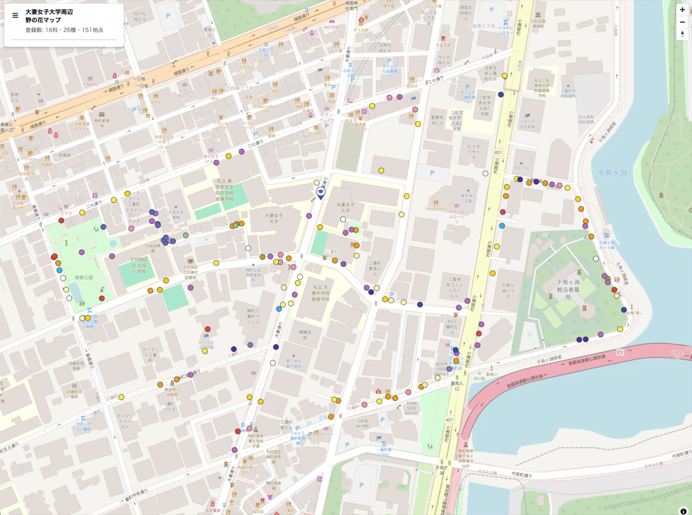

# wildflower_map
Interactive map of wildflowers around the Otsuma Women's University campus

## Motivation
Cities are largely artificial environments, dominated by buildings, roads, and other human-made structures. With so little nature around them, urban residents have gradually lost interest in the natural world, a trend often described as a "disconnection from nature." This growing distance from nature also weakens people's attachment to it.

To rekindle this fading interest and attachment, the first step is to notice the nature that already exists in our everyday surroundings. After all, we cannot care about something we do not know is there.

With this in mind, we, members of the Conservation Biology Lab at Otsuma Women's University, turned our attention to the often-overlooked nature beneath our feet. We surveyed which wild plants grow where, and in what abundance, and visualized the results on an interactive web map.

## Screenshot

## Link
▶ [https://yskoseki.github.io/wildflower_map/](https://yskoseki.github.io/wildflower_map/)