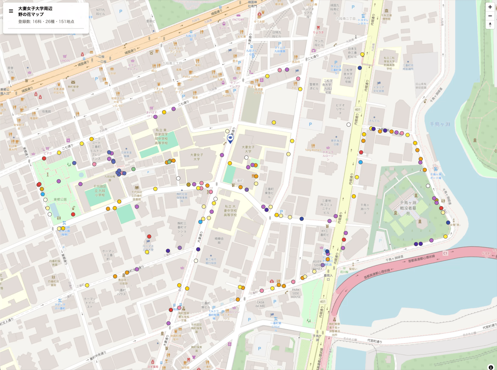

# wildflower_map
Interactive map of wildflowers around the Otsuma Women's University campus

## Motivation
Cities are made up mostly of buildings, roads, and other human-made structures. With so little nature around them, many city dwellers have slowly lost interest in the natural world. This is often called “disconnection from nature.” As people drift away from nature, they also come to care less about it.

To bring back this interest and care, the first step is to notice the nature that is already around us in daily life. After all, we can’t care about something we don’t know is there.

With this in mind, we, members of the Conservation Biology Lab at Otsuma Women’s University, took a closer look at the nature under our feet that often goes unnoticed. We recorded which wild plants grow where, and how many of them there are, and shared the results on an interactive web map.

## Screenshot

## Link
▶ [https://yskoseki.github.io/wildflower_map/](https://yskoseki.github.io/wildflower_map/)